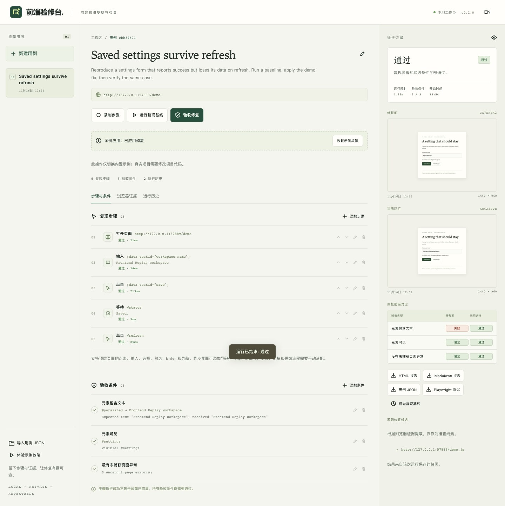

# Frontend Replay · 前端验修台

**Record the bug. Keep the evidence. Verify the fix.**

[简体中文](./README.zh-CN.md) · [npm](https://www.npmjs.com/package/dsh-frontend-replay) · [GitHub](https://github.com/zhan1024/dsh-frontend-replay) · [Releases](https://github.com/zhan1024/dsh-frontend-replay/releases)

Frontend Replay is a DeepSeek Harness (DSH) plugin and local frontend acceptance workbench. It turns browser interactions into replayable steps, collects screenshots and browser diagnostics, and reruns explicit acceptance conditions after your application changes.

The distinction matters: **successful clicks do not prove a fix**. Frontend Replay reports `passed` only when every replay step and every acceptance condition succeeds. A recording or a case with no acceptance conditions is `unverified`. Every run stores its own case snapshot, so editing a case never rewrites previous evidence. A comparison warns when the steps or conditions changed.



## Migrating from Repro

`dsh-repro` is now **`dsh-frontend-replay`**, starting at **0.2.0**. Search for the full package name or **前端验修台**. If you installed the old plugin, remove it before installing this package to avoid registering the same agent tools twice:

```sh
dsh plugin --profile web remove dsh-repro
```

Your `.dsh-repro/` cases and evidence remain compatible. The `DSH_REPRO_DIR` / `DSH_REPRO_HEADLESS` settings, `repro_*` tool names and JSON format stay supported. The old `dsh-repro` CLI is retained as an alias. Historical v0.1.0 packages remain available.

## Install

The standalone plugin requires Node.js **22.15+**. DSH integration is tested against **0.2.2-rc.1**, whose CLI requires Node.js **24.9+**; profile installation also needs pnpm 10+.

See the [development, publishing, distribution and installation guide (中文)](./docs/DEVELOP-PUBLISH-DISTRIBUTE.zh-CN.md) for reproducible commands and current marketplace submission status.

### From npm

```sh
# A prebuilt bundle: no TypeScript build scripts run inside your DSH profile.
dsh plugin --profile web add dsh-frontend-replay@0.2.0

# Install the matching Chromium once.
npm exec --yes --package=dsh-frontend-replay@0.2.0 -- dsh-frontend-replay install-browser
```

Restart `dsh web`, then ask:

> Open the Frontend Replay workbench. I want to record a frontend bug and verify its fix.

The agent calls `repro_open` and returns a local workbench URL. Open the **complete** URL; its `#token` fragment authorizes your browser session.

The identical prebuilt package is also available as a [GitHub release asset](https://github.com/zhan1024/dsh-frontend-replay/releases/tag/v0.2.0):

```sh
dsh plugin --profile web add https://github.com/zhan1024/dsh-frontend-replay/releases/download/v0.2.0/dsh-frontend-replay-0.2.0.tgz
```

### Standalone workbench

```sh
npm exec --yes --package=dsh-frontend-replay@0.2.0 -- dsh-frontend-replay --open
```

No DSH installation or model API key is needed for the standalone workbench.

## A complete workflow

1. **Create a case.** Set the title, target URL, and bug description.
2. **Record steps.** Frontend Replay opens its own Chromium window. Reproduce the bug there, then click **Stop & save** in the workbench. Alternatively, author steps manually or ask the agent to create them.
3. **Define acceptance.** Add observable conditions: visible/hidden elements, text, URL, an HTTP response, or absence of browser errors. Add a **Wait** step before an asynchronous transition when needed.
4. **Run baseline.** Save pre-fix evidence using the steps and conditions you intend to verify.
5. **Fix your application.** Edit its source code yourself or with your DSH agent; start/rebuild the application as needed.
6. **Verify fix.** Replay in a fresh browser context. Inspect condition results and before/after screenshots. If you changed the test definition, the comparison says so.
7. **Export evidence.** Download a self-contained HTML report, Markdown, case JSON, or a standalone Playwright test.

**Try the sample bug** provides a local settings form that reports a successful save but loses the name on refresh. Run a baseline, select **Apply demo fix**, then verify the same case. That toggle changes only the bundled sample application, never your project's source.

## Steps and acceptance conditions

| Step | Fields |
| --- | --- |
| `navigate` | `url` (absolute HTTP/HTTPS) |
| `click` | `selector` |
| `fill` | `selector`, `value` (empty string allowed) |
| `select` | `selector`, `value` (single native select) |
| `check` | `selector`, `checked` |
| `press` | `selector`, `key` |
| `reload` | none |
| `wait` | `selector`, optional `value` (wait for visible element containing text) |

Selectors use Playwright CSS locator semantics. Prefer a stable `[data-testid="save"]` or `#workspace-name` over positional selectors. Before a subsequent click or navigation, replay waits for a preceding write request to receive a response. Explicit Wait steps handle application-specific asynchronous UI changes.

| Condition | Fields / meaning |
| --- | --- |
| `visible`, `hidden` | `selector` |
| `text` | `selector`, nonempty `expected` substring of rendered text |
| `url` | nonempty `expected` URL substring |
| `request` | `expected` URL substring, `status` HTTP status |
| `no_page_errors` | no uncaught page exceptions |
| `no_console_errors` | no error-level console messages |
| `no_failed_requests` | no failed requests or responses with HTTP status >= 400 |

DOM/text/request conditions retry up to the configured timeout. Diagnostics are checked after other conditions, with an initial 350 ms settling window. Frontend Replay is not a monitor for arbitrarily late errors: use an explicit Wait step for the state your application must reach.

## DSH tools

| Tool | Purpose |
| --- | --- |
| `repro_open` | Start the local workbench and return its authorized URL |
| `repro_list` | List cases and current recording/run state |
| `repro_create` | Create a case with structured steps and conditions |
| `repro_update` | Edit a case, preserving old run snapshots |
| `repro_record` | Open the target browser and begin manual recording |
| `repro_stop_recording` | Save actions, diagnostics, and screenshot |
| `repro_run` | Replay; `kind: "baseline"` or `"verification"` |
| `repro_report` | Read run evidence and a Markdown report |
| `repro_export` | Export `json` or `playwright` |

Example instruction:

> Create a Frontend Replay case for http://localhost:5173/settings. Fill `[data-testid="workspace-name"]` with “Example”, click `[data-testid="save"]`, wait for `#status` to contain “Saved”, then reload. Verify that `#persisted-name` contains “Example” and there are no uncaught page errors. Run it as a baseline. After we fix the application, rerun exactly the same case as verification and inspect the report.

The plugin provides evidence and source-location candidates from logs. It does not claim those locations prove the root cause, and does not edit your application automatically. Code changes are performed by your DSH agent through its normal tools.

## Configuration

Default data directory: `.dsh-repro` under the launching working directory. Set an **absolute** `DSH_REPRO_DIR` when using DSH from multiple directories or launching from another application.

```sh
export DSH_REPRO_DIR=/absolute/path/to/project/.dsh-repro
dsh web
```

Profile override (`$DSH_HOME/profiles/web/cordis.patch.yml`):

```yaml
- id: dsh-frontend-replay
  config:
    dataDir: /absolute/path/to/project/.dsh-repro
    headless: false
    timeoutMs: 5000
    port: 0
    # executablePath: /path/to/custom/chromium
```

`headless` controls **recording**; replay always uses headless Chromium. `port: 0` picks a free loopback port. A profile override replaces the whole config row, so restate fields you want to retain. `DSH_REPRO_HEADLESS=1` enables headless recording for automated testing.

Standalone options:

```sh
dsh-frontend-replay --port 4317 --data-dir .dsh-repro --open
dsh-frontend-replay --headless --browser-path /path/to/chromium
dsh-frontend-replay install-browser --with-deps  # Linux CI / system dependencies
```

## Data and limits

- Captures **top-level** page clicks, text input, single selects, checkbox/radio changes, Enter, and navigation/reload. Iframes, popups, uploads, drag-and-drop, canvas interactions, contenteditable fields and multi-selects need a manually adapted test. Review captured steps after delayed/automatic navigation and add explicit Navigate, Reload or Wait steps when needed. Cases do not save authentication state; use recorded login steps.
- Browser contexts are isolated for every run. Use test data and a target application where replaying writes is appropriate. The target application's own backend state is not reset automatically.
- Password-like inputs are recorded as `${ENV:REPRO_SECRET_1}` placeholders. Set the corresponding variable before starting Frontend Replay. Secret inputs and `[data-repro-private]` elements are masked in screenshots. Common credential patterns in logs and URL queries are redacted; arbitrary page content and screenshots can still contain application data.
- Does not persist request/response bodies, cookies, storage state or raw authorization headers. Stores case input, run JSON, console/page errors, request URLs/statuses, and screenshots locally. Add `.dsh-repro/` to your project's `.gitignore`.
- Maximum 500 steps, 100 conditions, 1,000 browser evidence entries per run. Excess evidence is bounded. No cloud upload, analytics, external font or CDN request from the workbench.
- The workbench listens on `127.0.0.1`, requires a startup token for API access, validates Host and Origin, and serializes recording/replay. Do not share the token-bearing URL.
- Generated tests need `@playwright/test` in the receiving project. A case without conditions produces a **skipped** test. HTML reports embed screenshots; Markdown references `artifacts/<run-id>/screenshot.png` relative to the data directory.

## Develop and verify

```sh
npm ci
npm run browsers
npm run typecheck
npm test
npm run test:e2e
npm run test:dsh
npm pack --dry-run
```

`test:e2e` uses real Chromium to record trusted browser interactions, observe a failed baseline, apply the demo fix, and verify the unchanged test. It also checks error diagnostics, cancellation, the workbench UI, responsive layout, and HTML export.

`test:dsh` packs the plugin, installs the tarball into a temporary DSH profile, and drives `repro_create → repro_run → repro_report` through the actual agent loop using a deterministic local OpenAI-compatible model. It requires pnpm 10+ and installs DSH on first run. Use `DSH_BIN=/path/to/dsh` to reuse an installation. If npm is configured with `legacy-peer-deps=true`, install DSH with that option explicitly disabled so its Cordis peer packages are present.

See [product design](./docs/DESIGN.md) and [release verification](./docs/VERIFICATION.md) in the source repository.

## License

MIT.
