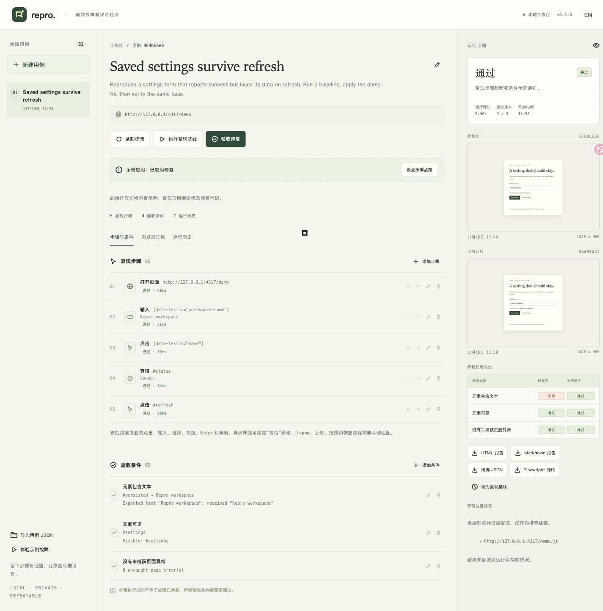

# Repro · 前端故障复现与验收助手

**留下复现步骤和证据，用同样的条件验收修复。**

[English](./README.md) · [源码](https://github.com/zhan1024/dsh-repro) · [版本与安装包](https://github.com/zhan1024/dsh-repro/releases)

Repro 是 DeepSeek Harness（DSH）插件，同时提供独立的本地工作台。它把浏览器操作保存为可重放的步骤，采集控制台、页面异常、网络请求和截图，并在修改应用后重新执行验收条件。

只有步骤执行成功且所有验收条件通过，才显示“通过”。只完成录制或没有验收条件，均显示“尚未验证”。每次运行保存当时的用例快照；修改步骤和条件会显示对比提示，历史证据不会被覆盖。



## 安装与启动

需要 Node.js **22.15+**，建议 Node 24 LTS。DSH 的插件安装还需要 pnpm 10+。当前已验证 DSH **0.2.2-rc.1**。

```sh
# 从预构建版本安装插件
dsh plugin --profile web add https://github.com/zhan1024/dsh-repro/releases/download/v0.1.0/dsh-repro-0.1.0.tgz

# 安装配套 Chromium，仅需执行一次
npm exec --yes --package=https://github.com/zhan1024/dsh-repro/releases/download/v0.1.0/dsh-repro-0.1.0.tgz -- dsh-repro install-browser

dsh web
```

在 DSH 中输入：

> 打开 Repro 工作台，我要录制一个前端故障并验收修复。

Agent 会调用 `repro_open` 返回本机地址。打开包含 `#token` 片段的**完整地址**。

也可以独立使用，无需模型 API Key：

```sh
npm exec --yes --package=https://github.com/zhan1024/dsh-repro/releases/download/v0.1.0/dsh-repro-0.1.0.tgz -- dsh-repro --open
```

## 完整使用流程

1. **新建用例**：填写名称、页面地址和故障描述。
2. **录制步骤**：在新打开的 Chromium 中复现，回到工作台点击“停止并保存”。也可以手动编辑或让 Agent 创建结构化步骤。
3. **明确验收条件**：例如保存后刷新，`#persisted-name` 仍包含刚才输入的内容。异步操作之间可添加“等待元素可见/包含文本”步骤。
4. **运行复现基线**：保存修复前的步骤结果、断言、网络与异常证据。
5. **修改真实应用代码**：由你或 DSH Agent 完成，并确保应用已重新运行或构建。
6. **验收修复**：在新的独立浏览器上下文重放，检查条件结果和前后截图。
7. **导出**：独立 HTML 报告、Markdown、用例 JSON，或可加入项目测试的 Playwright 用例。

点击“体验示例故障”，可体验“保存成功但刷新后数据丢失”的本地演示：先运行基线，再“应用示例修复”，最后用同一用例验收。这个开关只修改内置示例的行为。

## 能力与限制

- 步骤：打开页面、点击、输入、单选下拉、勾选、按键、刷新、等待。
- 条件：元素可见/隐藏、元素包含文本、URL 包含、接口返回指定 HTTP 状态、无未捕获页面异常、无控制台错误、无失败请求或 HTTP 错误。
- 录制支持顶层页面的点击、输入、选择、勾选、Enter、导航与刷新。iframe、文件上传、拖拽、canvas、富文本、多窗口和多选下拉需要手动适配。延迟跳转和自动导航后，请检查录制步骤，按需补充打开页面、刷新或等待。
- 每次运行使用独立上下文，不自动保存登录态，也不重置目标应用的后端数据。登录可作为录制步骤的一部分。
- 断言最多等待 `timeoutMs`；先等待 350 ms，再执行 DOM/请求断言，最后检查异常。更晚发生的应用变化需要增加明确的等待步骤。
- 源码位置来自浏览器堆栈等证据，是排查候选，不能直接视为已确认的根因。Repro 不自动修改应用，DSH Agent 可用其常规代码工具继续修复。

## DSH 工具

| 工具 | 功能 |
| --- | --- |
| `repro_open` | 打开本地工作台 |
| `repro_list` | 查询用例和运行状态 |
| `repro_create` / `repro_update` | 创建、编辑步骤与条件 |
| `repro_record` / `repro_stop_recording` | 开始、结束手动录制 |
| `repro_run` | 基线重放或修复验收 |
| `repro_report` | 读取历史证据和报告 |
| `repro_export` | 导出 JSON 或 Playwright 测试 |

可以直接对 Agent 说：

> 为 http://localhost:5173/settings 创建 Repro 用例：在 `[data-testid="name"]` 输入“示例项目”，点击 `[data-testid="save"]`，等待 `#status` 包含“保存成功”，然后刷新。验收 `#persisted-name` 包含“示例项目”，且没有未捕获页面异常。先运行复现基线，等代码修复后用同样用例验收。

## 配置与本地数据

默认保存在启动目录的 `.dsh-repro/`。从不同目录运行 DSH 时，建议指定绝对路径：

```sh
export DSH_REPRO_DIR=/你的项目路径/.dsh-repro
dsh web
```

Profile 配置示例：

```yaml
- id: dsh-repro
  config:
    dataDir: /你的项目路径/.dsh-repro
    headless: false
    timeoutMs: 5000
    port: 0
```

`headless` 仅控制录制窗口，自动重放始终无头运行。`port: 0` 自动选择空闲端口。独立启动可使用 `--port`、`--data-dir`、`--open`、`--browser-path`。

密码类输入默认保存为 `${ENV:REPRO_SECRET_1}` 等占位符，请在启动进程前设置对应环境变量。密码输入和 `[data-repro-private]` 元素在截图中会被遮盖；日志和 URL 中常见的凭据会脱敏。其他页面内容及截图仍可能包含应用数据。请把 `.dsh-repro/` 加入目标项目的 `.gitignore`，导出前检查证据。

不保存原始请求/响应体、Cookie、浏览器存储或鉴权请求头。工作台只监听 `127.0.0.1`，API 需要启动令牌，并校验 Host 和 Origin。用例上限 500 步、100 条条件，单次运行最多保留 1000 条浏览器证据。工作台不上传数据或加载远端字体。

HTML 报告内嵌截图，可以直接发送。Markdown 中的截图路径相对于数据目录，分享时需要同时携带对应 artifacts 文件。生成的测试需要目标项目安装 `@playwright/test`；无验收条件的用例会标为 skipped。

## 开发和验证

```sh
npm ci
npm run browsers
npm run typecheck
npm test
npm run test:e2e
npm run test:dsh
npm pack --dry-run
```

真实浏览器测试覆盖手动录制、修复前失败/修复后通过、步骤失败、无断言、异常与网络证据、取消运行、工作台操作、移动端宽度和报告导出。DSH 集成测试从 tarball 安装插件，在真实 Agent 循环中调用创建、重放和报告工具。

首次 DSH 测试会安装 Harness。可用 `DSH_BIN=/path/to/dsh` 复用现有安装。如果本机启用了 `legacy-peer-deps=true`，安装 DSH 时需显式关闭此选项，确保 Cordis 等 peer 依赖齐全。

MIT 许可证。
