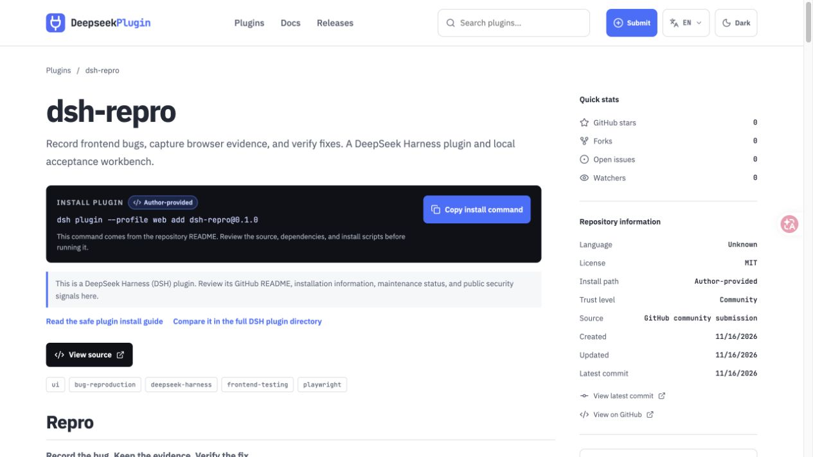

# Repro 核心开发、发布、市场投稿与下载安装手册

记录日期：2026 年 11 月 16 日。版本：`dsh-repro@0.1.0`。

本手册记录已经执行的工作，以及之后发布新版本可以复用的步骤。市场状态是本次核验的快照，实际进度以对应 PR、Issue 和公开目录为准。

## 1. 本次交付和渠道状态

Repro 的完整功能链路是：创建故障用例 → 录制或编写步骤 → 设置验收条件 → 保存修复前基线 → 修改应用 → 用相同条件重放 → 比较证据 → 导出报告或测试。

| 渠道 | 本次实际状态 | 入口或凭证 |
| --- | --- | --- |
| npm | `dsh-repro@0.1.0` 已公开，匿名下载和实际安装通过 | [npm 包](https://www.npmjs.com/package/dsh-repro) |
| GitHub | 源码、v0.1.0 Release、预构建安装包、校验和与示例报告已公开 | [仓库](https://github.com/zhan1024/dsh-repro) · [Release](https://github.com/zhan1024/dsh-repro/releases/tag/v0.1.0) |
| DeepseekPlugin | 已自动发布，详情页显示 README 和正确安装命令；另用不带登录信息的 HTTP 请求确认服务端存在此条目 | [公开详情](https://deepseekplugin.org/en/plugins/submitted?slug=zhan1024-2f-dsh-2d-repro) |
| DSHMarket / awesome-dsh-plugin | 已提交收录 PR，等待年龄门槛、CI 与维护者审核；尚未认定市场上线 | [PR #15772](https://github.com/awesome-dsh-plugin/awesome-dsh-plugin/pull/15772) · [DSHMarket](https://dshmarket.com/zh/) |
| dshplugin.io | 已按站点的 Submit plugin 入口提交 GitHub Issue，等待维护者处理 | [投稿 #50](https://github.com/tjsdyy/dshplugin/issues/50) · [目录](https://dshplugin.io/) |

DSHMarket 的收录源要求仓库创建满 1 天。本仓库创建于 `2026-11-16T03:54:47Z`，于 **2026 年 11 月 17 日 11:54:47（北京时间，UTC+8）**满 24 小时。PR 中如实保留了未勾选的年龄检查项。上游脚本按当前时间计算年龄，并会定期重跑因年龄失败的 gate；到时无需空提交或重开 PR。满 24 小时只解决这一项，最终上线仍取决于人工审核、合并和索引更新。

另检查了 dsh.directory 和 dshx.cn：本次环境分别遇到连接关闭和证书域名错误，未能提交。以上渠道均按实际适配 DSH 的能力选择，没有可核实的流量排名或下载量保证。DSH bundle 需要平台适配才能作为 VS Code、Claude 或其他宿主的原生插件发布。



## 2. 核心开发：让功能与宿主加载分别成立

Harness 负责模型、Agent 循环、工具注册、会话、配置和生命周期。Repro 是被 Harness 加载的扩展：模型调用 Repro 工具，工具执行真实浏览器操作，再把结构化结果送回 Agent。独立工作台和 DSH 工具共用同一个引擎，避免两套执行逻辑产生不同结果。

| 文件 | 作用 |
| --- | --- |
| `src/model.ts` | 用例、步骤、验收条件、运行结果的类型与输入校验、凭据脱敏 |
| `src/browser.ts` | Playwright Chromium 启动、录制、选择器和浏览器证据采集 |
| `src/engine.ts` | 录制/重放互斥、基线、验收、运行快照、取消与资源回收 |
| `src/store.ts` | 本地用例、运行 JSON、截图目录的持久化 |
| `src/report.ts` | Markdown、HTML 报告以及可独立运行的 Playwright 测试导出 |
| `src/server.ts` | 本机工作台 HTTP/API、鉴权、Host/Origin 检查 |
| `src/index.ts` | DSH 插件入口、工具 JSON Schema、注册和卸载清理 |
| `src/cli.ts` | 独立启动、打开工作台和安装配套 Chromium |
| `ui/` | 中英文工作台、录制/验收状态、证据与前后对比 |

核心判定必须先确定：步骤失败则运行失败；所有步骤和所有验收条件成功才通过；没有验收条件仍为 `unverified`。每次运行保存当时的用例快照；改变步骤或断言后，不能用旧基线直接证明同一问题已经修复。测试浏览器每次创建独立上下文。

当前注册九个工具：`repro_open`、`repro_list`、`repro_create`、`repro_update`、`repro_record`、`repro_stop_recording`、`repro_run`、`repro_report`、`repro_export`。工具包含参数 schema、输出 schema/文本呈现和可取消的执行函数。插件通过 `inject = ['tools']` 获取工具服务，在 `apply()` 中注册，通过 `ctx.effect()` 清理引擎和工作台。

### DSH 能安装的关键声明

`package.json` 的相关片段：

```json
{
  "name": "dsh-repro",
  "type": "module",
  "main": "./dist/index.js",
  "types": "./dist/index.d.ts",
  "bin": { "dsh-repro": "./dist/cli.js" },
  "dsh": { "bundle": { "patch": "./cordis.patch.yml" } },
  "scripts": { "prepack": "npm run build" }
}
```

根目录 `cordis.patch.yml`：

```yaml
- insert:
    - id: dsh-repro
      name: dsh-repro
      config:
        dataDir: !!js process.env.DSH_REPRO_DIR || '.dsh-repro'
        headless: !!js process.env.DSH_REPRO_HEADLESS === '1'
```

`dsh.bundle` 把包接入 profile，`cordis.patch.yml` 说明加载哪个插件和配置。只写 `dsh.client` 不能替代 bundle。Repro 的工作台是独立的本机页面，通过 `repro_open` 返回地址，因此本包不需要声明嵌入 DSH 前端的 client 入口。

`files` 白名单应包含 `dist/`、`ui/`、文档、patch、README 和许可证；构建结果需在包中真实存在。官方宿主包如需依赖，应按其扩展契约使用 peerDependencies，避免打包第二份宿主运行时。本插件运行时直接依赖固定版本的 Playwright。

## 3. 本地开发与验收

独立模式要求 Node.js 22.15+。本次集成测试所用 DSH 0.2.2-rc.1 自身要求 **Node.js 24.9+**；profile 安装还需要 pnpm 10+。建议整个开发环境采用受支持的 Node 24 LTS 版本。

```sh
git clone https://github.com/zhan1024/dsh-repro.git
cd dsh-repro
npm ci
npm run browsers
npm run typecheck
npm test
npm run test:e2e
npm run test:dsh
npm pack --dry-run --json
git diff --check
```

本次已完成：严格 TypeScript 检查、6 项单元/API 测试、7 项真实 Chromium 测试，以及真实 DSH Agent 循环测试。CI 使用 Ubuntu 和 Node 24。详细证据见 [VERIFICATION.md](./VERIFICATION.md) 和 [PUBLISHED-VERIFICATION.md](./PUBLISHED-VERIFICATION.md)。

`test:dsh` 把打包产物装进临时 profile，再通过本地确定性模型服务驱动 `repro_create → repro_run → repro_report`；它验证真实工具协议、包加载、浏览器和结果回传，不评估大模型自主推理质量。可设置 `DSH_BIN=/path/to/dsh` 复用 DSH。

如果机器的 npm 全局配置为 `legacy-peer-deps=true`，安装测试用 DSH 时应局部指定 `--legacy-peer-deps=false`，以安装其 Cordis peer 依赖；无需修改用户全局配置。

开发时打开工作台：

```sh
npm run build
npm start -- --open
```

手动验证：点击“体验示例故障”→ 保存基线并观察失败 → 点击“应用示例修复”→ 用相同用例验收通过 → 下载 HTML 和 Playwright 测试。这个开关只改变内置示例，真实项目需由开发者或 Agent 修改代码。

## 4. 打包和 npm 发布

先确认 `repository.url` 指向自己的公开仓库、版本号正确、MIT 许可证和双语说明齐全。在 GitHub 添加 `dsh-plugin` topic。`npm pack --dry-run --json` 用于审查包清单，确认存在预构建 JS、类型、工作台资源和 patch，且不包含环境文件、凭据、node_modules 或 `.dsh-repro/` 运行数据。

以下是**下一次版本发布的示例**，并非要求重新发布已存在的 0.1.0；`0.1.1` 只是示例版本，实际应按改动选择尚未占用的版本。先完成代码和文档，再执行：

```sh
REPRO_VERSION=0.1.1
npm version "$REPRO_VERSION" --no-git-tag-version
npm run typecheck
npm test
npm run test:e2e
npm run test:dsh
npm pack --dry-run --json
git diff --check
```

把该版本的代码、package.json、lockfile 和说明提交到 Git。发布标签应固定到这个经过验证的提交，不要移动旧标签。

```sh
git add package.json package-lock.json src ui test docs README.md README.zh-CN.md cordis.patch.yml
git commit -m "release: v$REPRO_VERSION"
git tag "v$REPRO_VERSION"
git push origin main
git push origin "v$REPRO_VERSION"

REPRO_ASSETS=$(mktemp -d)
npm pack --pack-destination "$REPRO_ASSETS"
(cd "$REPRO_ASSETS" && shasum -a 256 "dsh-repro-$REPRO_VERSION.tgz" > SHA256SUMS)
```

首次或登录失效时运行 `npm login --auth-type=web --registry=https://registry.npmjs.org/`。用户在 npm 官方页面完成登录、CLI 授权及要求的二次验证；网站已登录与终端获得授权是不同状态。不要把密码、Token 或验证码写进代码、文档或聊天。

```sh
npm whoami --registry=https://registry.npmjs.org/
npm publish "$REPRO_ASSETS/dsh-repro-$REPRO_VERSION.tgz" --access public --registry=https://registry.npmjs.org/
npm view "dsh-repro@$REPRO_VERSION" version dist.tarball dist.integrity --json --registry=https://registry.npmjs.org/
```

本次首次发布后，npm 约经过 6 分钟的处理才可公开获取。这是本次观察，不是固定等待时间。发布后必须确认 registry 元数据与 tarball 可匿名访问，再做安装测试；终端显示上传成功不等于已经可下载。

## 5. GitHub Release 与发布包复验

GitHub Release 上传与 npm **同一份** `.tgz`，附 SHA256SUMS、版本说明、验证记录和示例报告。先准备好 `release-notes.md` 的实际内容，再创建 Release：

```sh
gh release create "v$REPRO_VERSION" \
  "$REPRO_ASSETS/dsh-repro-$REPRO_VERSION.tgz" \
  "$REPRO_ASSETS/SHA256SUMS" \
  --repo zhan1024/dsh-repro \
  --verify-tag \
  --title "Repro v$REPRO_VERSION" \
  --notes-file release-notes.md
```

本次 v0.1.0 的发布源码为 `5838f961b523fa180add449257091f6d949fe606`。npm 与 GitHub tarball 的 SHA-256 相同：

```text
fb587af402198702e37f0d932e54823202c391d0546dc4019ee071f9f06bf294
```

从公开地址再次安装，才能发现“源码能跑但发布包缺文件”的问题。本次两个来源均已装进不同的全新 DSH profile 并运行 Agent 验收。重跑当前已发布版本：

```sh
DSH_BIN=/path/to/dsh REPRO_PLUGIN_SPEC=dsh-repro@0.1.0 npm run test:dsh

DSH_BIN=/path/to/dsh \
  REPRO_PLUGIN_SPEC=https://github.com/zhan1024/dsh-repro/releases/download/v0.1.0/dsh-repro-0.1.0.tgz \
  npm run test:dsh
```

CLI 下载验证应在独立空目录进行，例如 `mktemp -d` 后进入该目录，再执行 `npm exec --yes --package=dsh-repro@0.1.0 -- dsh-repro --help`。在插件自己的源码目录运行时，npm 可能优先识别当前同名项目，无法证明 registry 下载链路。

## 6. 上传到市场：不同渠道分别提交

### DSHMarket / awesome-dsh-plugin

本次核对到 DSHMarket 从 awesome-dsh-plugin 目录构建索引。向该仓库提交一个条目文件，经 CI、人工审核、合并、索引刷新后，才形成市场入口。这里上传的是目录元数据，实际安装包仍来自 npm 或 GitHub Release。

在插件自己的仓库根目录加入 `screenshots.json`：

```json
["docs/workbench.jpg"]
```

目录允许 1–8 张截图，优先使用仓库内相对路径；图标使用 GitHub 托管的 PNG/JPG/WebP。Repro 将现有 SVG 图标转为 PNG，并未新增设计或运行时代码。截图后续在自己的仓库更新即可。

Fork `awesome-dsh-plugin/awesome-dsh-plugin`，新建分支，只添加 `data/plugins/zhan1024__dsh-repro.yml`：

```yaml
url: https://github.com/zhan1024/dsh-repro
name: zhan1024/dsh-repro
category: browser
description:
  en: Record and replay frontend bugs, compare baseline and verification evidence against explicit acceptance conditions, and export reports and Playwright tests.
  zh: 录制与重放前端缺陷，按明确验收条件对比基线和验证证据，并导出报告与 Playwright 测试。
tarball: https://github.com/zhan1024/dsh-repro/releases/download/v0.1.0/dsh-repro-0.1.0.tgz
icon: https://raw.githubusercontent.com/zhan1024/dsh-repro/main/docs/icon.png
```

不要手工修改上游生成的 README，不要在 YAML 添加 `npm:` 字段；npm 包通过自身 `repository` 字段与目录关联。固定 Release tarball 可以为预构建安装提供明确的备用来源。

本地在目录仓库安装依赖后，用其 `scripts/lib/entries.mjs` 的 `readEntries()` / `validateEntries()` 校验 schema、文件名与重复 URL，再运行 `git diff --check`。推送分支并创建 PR。本次只新增上述一个文件，PR 为 [#15772](https://github.com/awesome-dsh-plugin/awesome-dsh-plugin/pull/15772)。

提交前需满足 bundle、真实代码、`dsh-plugin` topic、仓库年龄等规则。Repro 的年龄尚未达到，因此申请中准确注明达标时间，等待上游自动重新检查及维护者审核。其他 CI 失败应读取具体日志并修复，不能把所有红灯都归因于年龄。

合并后，再在市场搜索 `dsh-repro`，确认作者、版本和安装命令，完成一次从市场入口到真实安装的验证。市场索引刷新有延迟，不能把 PR 已提交或合并直接写成全部市场已经可下载。规则来源：[贡献指南](https://github.com/awesome-dsh-plugin/awesome-dsh-plugin/blob/main/contributing.md)。

### DeepseekPlugin

进入 [提交页](https://deepseekplugin.org/en/submit)，填公开 GitHub 仓库地址，执行其自动发布操作。页面解析 repository、topic、bundle 和 README 后生成详情。

本次页面返回发布成功，详情显示 `dsh plugin --profile web add dsh-repro@0.1.0`。随后通过匿名 GET `https://deepseekplugin.org/api/submissions/zhan1024-2f-dsh-2d-repro` 得到 `ok: true`、正确仓库 URL、`installable: true` 和同一安装命令，确认服务端条目存在。页面截图保存在本手册上方。

### dshplugin.io

站点的 Submit plugin 指向其 GitHub 仓库 Issue。提交仓库、版本、双语描述、分类、manifest、安装命令、Release、截图和验证记录。本次已建立 [Issue #50](https://github.com/tjsdyy/dshplugin/issues/50)。Issue 处于开放状态只代表投稿已送达；须等维护者处理并在目录实际检索到插件，才能报告上架。

## 7. 别人如何下载、安装和使用

已有 DSH 环境时直接执行：

```sh
dsh plugin --profile web add dsh-repro@0.1.0
npm exec --yes --package=dsh-repro@0.1.0 -- dsh-repro install-browser
dsh web
```

在 DSH 中说：“打开 Repro 工作台，我要录制一个前端故障并验收修复。”Agent 调用 `repro_open`，打开它返回的完整本机地址。首次使用 DSH 本身还需按宿主引导配置模型；独立工作台无需模型账号。

尚未安装宿主时，可在 Node 24.9+ 环境安装本次测试所用版本，已有环境则跳过：

```sh
npm install -g pnpm@10
npm install -g --legacy-peer-deps=false @deepseek-ai/dsh@0.2.2-rc.1
```

上述命令固定在已测试版本，不代表它永远是最新 DSH。之后升级宿主或 Playwright 时，应重新跑集成测试。

也可从 Release 安装：

```sh
dsh plugin --profile web add https://github.com/zhan1024/dsh-repro/releases/download/v0.1.0/dsh-repro-0.1.0.tgz
```

安装 Chromium 后独立使用：

```sh
npm exec --yes --package=dsh-repro@0.1.0 -- dsh-repro --open
```

只下载 npm 安装包、不安装到 DSH：在目标下载目录执行 `npm pack dsh-repro@0.1.0 --registry=https://registry.npmjs.org/`；也可在 GitHub Release 的 Assets 下载 `.tgz` 和 SHA256SUMS，运行 `shasum -a 256 -c SHA256SUMS` 核对。

工作台使用流程：新建用例 → 录制 → 设置可观察的验收条件 → 运行基线 → 修复真实应用 → 验收 → 导出报告。默认数据目录是启动目录下 `.dsh-repro/`；跨目录启动时用绝对路径 `DSH_REPRO_DIR` 指定数据位置。

## 8. 后续升级、卸载与维护

发布新版本后，先让使用者核对版本，再用 `dsh plugin --profile web add dsh-repro@新版本` 更新，安装该版本匹配的 Chromium 并重启 DSH。卸载插件：

```sh
dsh plugin --profile web remove dsh-repro
```

卸载包不会自动删除项目保存的故障用例与证据。需要保留的报告应先导出；本机地址中的启动令牌不应写入公共说明或市场截图。

每次代码更新重复：测试 → 升版本 → 提交并固定标签 → 打出同一份包 → npm 发布 → Release 上传 → 公开下载复验 → 更新自己的市场条目或 Release tarball → 验证索引。仅修改 README、市场截图等展示材料，可以只推送源码文档；本次没有为这些材料重新占用 npm 版本或移动 v0.1.0 标签。

下载事件、安装次数和用户数不同。npm 统计、GitHub Release 附件统计应分别展示，不能相加后称为用户量。持续提高真实下载的工作是完善示例、解决安装失败、维护兼容版本并响应使用反馈。
