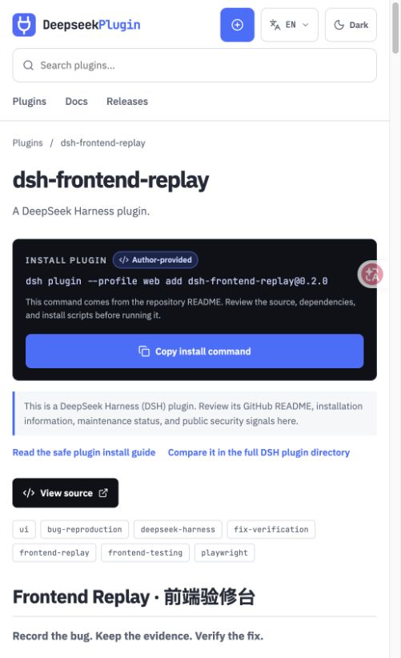

# Frontend Replay 0.2.0 · Published package verification

The plugin is renamed from Repro (`dsh-repro`) to **Frontend Replay · 前端验修台** (`dsh-frontend-replay`). Verification date: 2026-11-16.

## Source and CI

- Release source: commit `4725823d8530b442b5d4f479178cf63412513744`, fixed tag `v0.2.0`.
- Strict TypeScript checks passed; six unit/API tests and seven real Chromium tests passed, including English/Chinese branding, a failed baseline, a passing verification, reports and 390 px layout.
- Both GitHub Actions runs for this source passed: [43807089839](https://github.com/zhan1024/dsh-frontend-replay/actions/runs/43807089839) and [43807089767](https://github.com/zhan1024/dsh-frontend-replay/actions/runs/43807089767).
- The repository was renamed in place to `zhan1024/dsh-frontend-replay`, retaining its ID, history and creation time (`2026-11-16T03:54:47Z`).

## Published artifacts and installation

- [GitHub Release v0.2.0](https://github.com/zhan1024/dsh-frontend-replay/releases/tag/v0.2.0) is public, with the prebuilt package and `SHA256SUMS`.
- The Release tarball was downloaded anonymously: `dsh-frontend-replay-0.2.0.tgz`, **253845 bytes**.
- Its SHA-256 matches the original uploaded tarball: `8897bc33757f02bcec5c7bc2a727a35a4a3a887f3cc10bb250a0ef558e1e8a8e`.
- The public GitHub tarball installed into a fresh DSH profile; all nine tools registered, and create → real Chromium replay → report passed. The same integration passed with the locally packed bundle.
- [npm `dsh-frontend-replay@0.2.0`](https://www.npmjs.com/package/dsh-frontend-replay) is public; the registry's `latest` tag is `0.2.0`. Package name, version, repository metadata and CLI entries were checked in the downloaded package.
- The canonical npm tarball URL was downloaded anonymously. Its bytes and SHA-256 match the GitHub Release; npm SHA-512 integrity also passed: `sha512-mjVvwNkUqUW6MsaxxGKbR2mHSYuN5ZDWqGStpZrrPqKPLwB2Z8tAJKnEAG6ovOxIobb7WOWymjj3aGJc9Xvryg==`.
- Installed the published npm version into a second fresh DSH profile; all nine tools registered and create → Chromium replay → report passed.
- Ran `npm exec --yes --package=dsh-frontend-replay@0.2.0 -- dsh-frontend-replay --help` in an empty directory with a separate empty npm cache; the new command ran successfully.
- The initial registry tarball 404 had a 300-second negative cache. After it expired, the canonical URL and normal package installation succeeded; no package was republished.

The DSH integration uses `@deepseek-ai/dsh@0.2.2-rc.1` and a deterministic local model endpoint to exercise the real agent loop. It verifies tool registration, browser execution and persistence, rather than model reasoning quality.

## Distribution status

- [DeepseekPlugin](https://deepseekplugin.org/en/plugins/submitted?slug=zhan1024-2f-dsh-2d-frontend-2d-replay): the new-name public detail page was inspected, including the repository, bilingual README, screenshot and `dsh-frontend-replay@0.2.0` installation command.
- [DSHMarket catalog PR #15772](https://github.com/awesome-dsh-plugin/awesome-dsh-plugin/pull/15772): the existing PR remains open and unmerged. The repository reached 24 hours at 2026-11-17 03:54:47 UTC / 11:54:47 Asia/Shanghai. At the scheduled follow-up, the current upstream `check-submission.mjs` (blob `8364e4dae51c33f1be5a4006de766ccd0d0e177a`) was run locally for the single entry: `ok: true`, `checked: 1`, no failures or incomplete checks. The age checklist was updated in place. The hosted `check` passed, while `Submission gate` still showed the 2026-11-16 age snapshot and awaits the upstream automatic refresh. The public DSHMarket `index.json` contains no entry for either this package or the previous name; review and indexing remain pending.
- [dshplugin.io submission #50](https://github.com/tjsdyy/dshplugin/issues/50): rechecked on 2026-11-17; still open with zero comments and no maintainer feedback. The new name and published 0.2.0 package remain in the submission.
- The one-time follow-up for 2026-11-17 12:00 Asia/Shanghai has completed, and its automation has been deleted. No repeated submission, new npm version or tag movement was needed; no further recurring check was created.

Historical v0.1.0 artifacts and evidence remain in [PUBLISHED-VERIFICATION-0.1.0.md](./PUBLISHED-VERIFICATION-0.1.0.md). Existing tags and packages were retained. Documentation updates after publication do not replace the fixed v0.2.0 artifact.

Public new-name marketplace page captured after publication:

## Scheduled follow-up · 2026-11-17

- Anonymous npm and GitHub Release downloads were checked again; both still have SHA-256 `8897bc33757f02bcec5c7bc2a727a35a4a3a887f3cc10bb250a0ef558e1e8a8e`, 253845 bytes, and npm `latest` remains `0.2.0`.
- No maintainer comments or reviews requested changes on catalog PR #15772; only its old age verdict remains. No empty commit, resubmission or maintainer ping was made.
- DeepseekPlugin was previously verified in the public browser. Today's direct anonymous request returned 403, so the previous observation is retained without claiming a fresh page verification.
- Only status documentation and the existing PR age checklist were updated. The fixed v0.2.0 artifacts and historical evidence remain unchanged.
